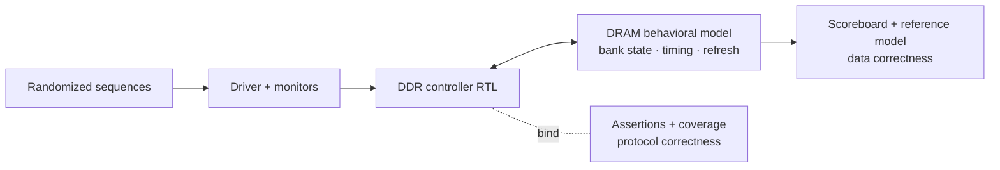
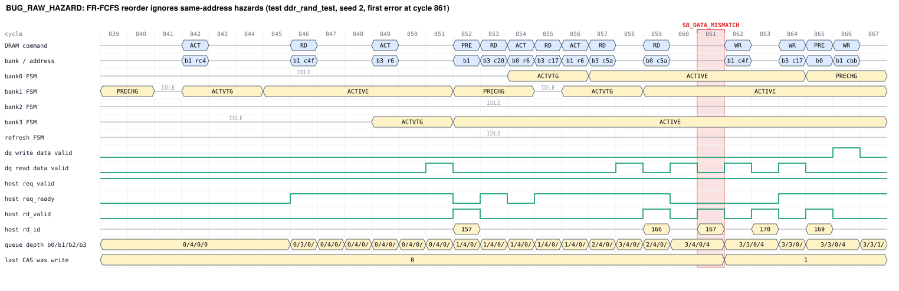

# DDR Memory Controller Verification Framework

A UVM verification environment for a DDR4-inspired 4-bank memory controller. It
automatically detects DRAM timing violations, corrupted data, refresh errors and
reordering races under constrained-random traffic.

**SystemVerilog · UVM (IEEE 1800.2) · SVA · Verilator 5.052 · Python**



## What's here

| Part | Files | Highlights |
|---|---|---|
| Controller RTL | `rtl/ddr_ctrl.sv`, `rtl/ddr_pkg.sv` | 4 banks, open page, per-bank queues, FR-FCFS reordering with same-address hazard check and starvation guard, ACT/RD/WR/PRE/PREA/REF/MRS, refresh and init FSMs, CL/CWL data pipes |
| DRAM model | `tb/dram/ddr_dram_model.sv` | turns protocol abuse into data corruption, as silicon would (premature reads, incomplete row restore, refresh retention loss) |
| Assertions | `tb/sva/*.sv` | about 50 properties in 3 bound checkers: pin-level timing (tRCD, tRP, tRAS, tRC, tRRD, tCCD, tRTP, tWR, tWTR, tRTW, tRFC, tREFI), illegal command sequences, FSM transitions, queue integrity, host protocol |
| UVM environment | `tb/uvm/` | agent, DRAM bus monitor, reference-model scoreboard with automatic mismatch diagnosis, latency watchdog, 9 sequences, 11 tests |
| Functional coverage | `tb/uvm/ddr_coverage.svh` | 103 planned bins: row hit/miss/conflict × bank × op, every timing constraint at its exact minimum, bank parallelism, hazards, out-of-order completion, refresh interruptions, back-to-back ops |
| Automation | `scripts/regress.py`, `scripts/bug_hunt.py`, `scripts/vcdwave.py` | parallel regression with coverage merging and matrix, bug-injection campaign, VCD-to-SVG waveforms |

Design spec: [docs/microarchitecture.md](docs/microarchitecture.md) · Verification plan:
[docs/verification_plan.md](docs/verification_plan.md)

## Results

- **Regression** ([reports/regression_summary.md](reports/regression_summary.md)): 9/9 runs pass,
  12,600 randomized requests checked end-to-end, **103/103 coverage bins closed**
  ([coverage matrix](reports/coverage_matrix.md)). This is the quick list. `make regress`
  runs the full list (39 runs, about 245k requests including a 100k-request soak), and
  a re-run seed is checked for bit-identical results.
- **Bug injection** ([reports/bug_detection.md](reports/bug_detection.md)): 10 RTL defects
  are available as `ifdef`s. In the demo, both bugs run were caught on every seed while the
  clean RTL passed the same seeds:
  - `BUG_TRCD_SHORT` (off-by-one timer): the assertion fires on the exact cycle of the
    premature RD/WR, and the scoreboard later sees the corrupted data.
  - `BUG_RAW_HAZARD` (missing hazard check in the reordering scheduler): no protocol rule is
    broken, so only the scoreboard catches it. It diagnoses the failure as "stale data from
    1 write earlier".



## Quick start (macOS / Linux)

```bash
brew install verilator z3        # Verilator >= 5.052 for UVM; z3 solves randomize()
make uvm                         # fetch Accellera UVM 2020.3.1
make run TEST=ddr_rand_test SEED=1
python3 scripts/regress.py --quick
make run BUG=BUG_TRCD_SHORT TEST=ddr_rand_test SEED=1 WAVES=1 TRACE=1
python3 scripts/bug_hunt.py --bugs BUG_TRCD_SHORT BUG_RAW_HAZARD --seeds 2 --num-txn 2000
```

## Tool notes

- Verilator 5.052 runs the real Accellera UVM library (`UVM_NO_DPI`). A full build takes
  about 35 s.
- Verilator silently ignores `dist` inside inline `randomize() with {}` blocks. All
  distributions here are class constraints, and `send()` self-checks that inline
  constraints were honored.
- Coverage uses explicit named bins exported as JSON, because Verilator compiles
  covergroups but doesn't report them yet.
