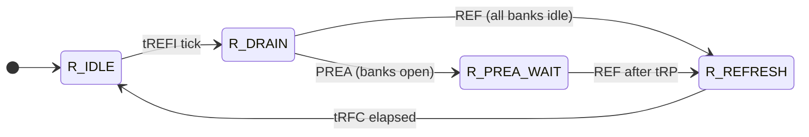

# Controller Microarchitecture (`rtl/ddr_ctrl.sv`)

A simplified, DDR4-inspired memory controller with 4 banks and an open-page policy. It is
small enough to read in one sitting but has the features that make real controllers hard
to verify: out-of-order scheduling, per-bank state machines, a dozen interacting timing
constraints, periodic refresh that interrupts traffic, and pipelined data paths.

## 1. Interfaces

**Host side** (all synchronous to `clk`, active-low async `rst_n`)

| Signal | Dir | Description |
|---|---|---|
| `req_valid / req_ready` | in / out | request handshake; `req_ready` is low until init completes and when the target bank's queue is full |
| `req_we`, `req_addr[21:0]`, `req_wdata[63:0]`, `req_id[7:0]` | in | operation, address `{bank[1:0], row[11:0], col[7:0]}`, write data, tag |
| `rd_valid`, `rd_id`, `rd_data` | out | read response, CL+1 cycles after the RD command (no back-pressure) |
| `wr_ack_valid`, `wr_ack_id` | out | write acknowledge, in the cycle the write data is driven to DRAM |
| `init_done` | out | power-up sequence finished |

Responses may come back **out of order** (tagged by ID). The controller guarantees
per-address ordering: a read always observes the latest write to the same address that
was accepted before it.

**DRAM side**

| Signal | Description |
|---|---|
| `dram_cs_n, ras_n, cas_n, we_n` | JEDEC command truth table: MRS 0000, REF 0001, PRE 0010, ACT 0011, WR 0100, RD 0101, NOP 0111, DES 1xxx |
| `dram_ba[1:0]`, `dram_addr[13:0]` | bank, row (ACT) / column (RD, WR) / mode (MRS); `A10=1` with PRE means precharge all (PREA) |
| `dram_wdata_valid`, `dram_wdata[63:0]` | write data, driven exactly CWL cycles after WR |
| `dram_rdata_valid`, `dram_rdata[63:0]` | read data from the device, CL cycles after RD |

## 2. Timing parameters (`rtl/ddr_pkg.sv`, in clock cycles)

| Parameter | Value | Constraint |
|---|---:|---|
| CL / CWL | 5 / 4 | RD to data / WR to data |
| tRCD | 4 | ACT to RD/WR, same bank |
| tRP | 4 | PRE to ACT, same bank |
| tRAS | 10 | ACT to PRE, same bank |
| tRC | 14 | ACT to ACT, same bank |
| tRRD | 2 | ACT to ACT, different banks |
| tCCD | 2 | CAS to CAS |
| tRTP | 3 | RD to PRE |
| tWR | 4 | end of write data to PRE (WR to PRE = CWL+1+tWR = 9) |
| tWTR | 3 | end of write data to RD (WR to RD = CWL+1+tWTR = 8) |
| RD to WR | 3 | bus turnaround, CL+2-CWL |
| tRFC | 24 | REF to any command |
| tREFI | 390 | refresh interval (contract: every interval at most tREFI + 32) |
| tMRD | 4 | MRS to any command |

The values are scaled down from DDR4 so randomized runs reach deep state quickly. The
relationships between them are preserved (tRC = tRAS + tRP, CL > CWL, tRFC much larger
than tRC, tREFI much larger than tRFC).

## 3. Block diagram

```mermaid
flowchart LR
  H[Host req] --> A{bank = addr[21:20]}
  A --> Q0[Bank 0 queue<br/>4 entries]
  A --> Q1[Bank 1 queue]
  A --> Q2[Bank 2 queue]
  A --> Q3[Bank 3 queue]
  Q0 & Q1 & Q2 & Q3 --> S[Per-bank FR-FCFS select<br/>+ hazard check + bypass limit]
  S --> ARB[Command arbiter<br/>CAS > ACT/PRE, round-robin]
  F[Bank FSMs + timers] <--> ARB
  R[Refresh FSM<br/>tREFI tick] --> ARB
  I[Init FSM<br/>MRS] --> ARB
  ARB --> CMD[Command register<br/>cs/ras/cas/we, ba, addr]
  ARB --> WP[Write pipe CWL] --> DQW[dram_wdata]
  ARB --> RP[Read tag pipe CL] --> RSP[rd_valid / rd_id]
  DQR[dram_rdata] --> RSP
```

## 4. Scheduling

**Per bank: FR-FCFS with a hazard check.** Each bank has a 4-entry queue with the oldest
entry at index 0. An entry is *eligible to bypass* if it hits the open row and **no older
entry in the same queue targets the same row and column**. Among eligible entries the
oldest one whose direction matches the previous column command wins, which reduces
read/write bus turnarounds. If none matches, the oldest eligible entry wins, and if no
entry is eligible the oldest entry is served (it needs PRE and/or ACT). After
`MAX_BYPASS = 4` consecutive bypasses the oldest entry is forced, which guarantees
progress.

**Across banks.** One command per cycle. Column commands (RD/WR) take priority over row
commands (ACT/PRE). Within each class banks are served round-robin starting after the
last bank served.

**Open-page policy.** Rows stay open after an access and are only closed by a conflict
(PRE) or by refresh (PREA).

## 5. State machines


Each bank has countdown timers that hold the earliest cycle at which the next command of
each kind may be decided: `rcd_cnt` (CAS), `rp_cnt` (to IDLE), `rc_cnt` (next ACT), and
`pre_cnt` (the maximum of tRAS, tRTP and write recovery). Global timers cover tRRD, tCCD
together with the turnarounds (`rd_cnt`, `wr_cnt`), and tRFC. A timer is loaded with
"constraint - 1" when the command is decided, because the decision is registered onto the
bus one cycle later.



While the refresh FSM is not idle no ACT/RD/WR is scheduled. PREA waits until every open
bank meets its precharge constraints. The refresh tick comes from a free-running counter,
so the average refresh rate is exactly 1/tREFI and each interval stays within
tREFI ± drain time.

**Init:** wait `T_INIT` cycles, issue MRS with `A[3:0]=CL`, `A[7:4]=CWL`, wait tMRD, then
raise `init_done`. The DRAM model takes CL/CWL from the MRS, so a wrong mode-register
encoding moves the data timing.

## 6. Simplifications vs. real DDR4

- A burst is a single 64-bit beat (BL abstracted). tCCD is still enforced and the data
  bus is checked for contention.
- 4 banks, no bank groups, so no tCCD_L/tCCD_S or tRRD_L/S. No tFAW (with 4 banks it
  would add little).
- No auto-precharge, ZQ calibration, ODT, power-down, self-refresh or refresh
  postponement.
- Read capture uses a fixed calibrated latency, so there is no DQS strobe.

## 7. Injectable defects

There are ten `ifdef BUG_*` hooks, described in
[`verification_plan.md` §7](verification_plan.md#7-bug-injection-plan). `make bugs` writes
the exact injected code, the failing seeds and waveforms to
[`reports/bug_detection.md`](../reports/bug_detection.md). With no `BUG_*` macro defined,
the RTL is the clean design.
