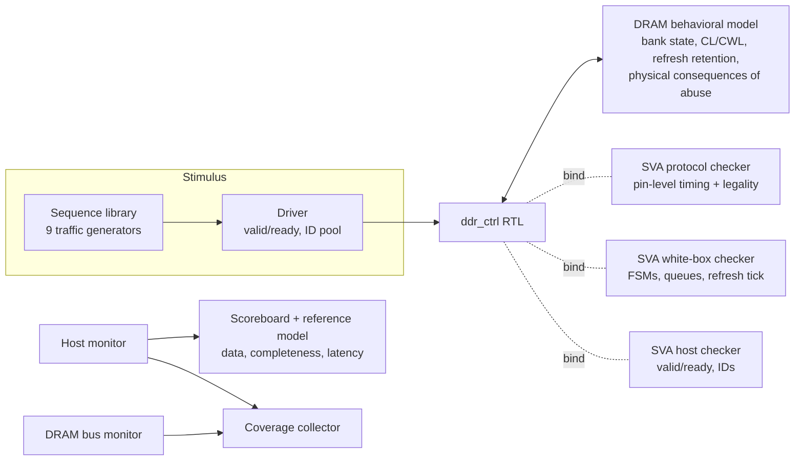

# Verification Plan: DDR4-Inspired 4-Bank Memory Controller

| | |
|---|---|
| DUT | `rtl/ddr_ctrl.sv` (spec: [microarchitecture.md](microarchitecture.md)) |
| Methodology | UVM 1800.2-2020 (Accellera 2020.3.1) + SystemVerilog Assertions, Verilator 5.052 |
| Sign-off results | [`reports/regression_summary.md`](../reports/regression_summary.md), [`reports/coverage_matrix.md`](../reports/coverage_matrix.md), [`reports/bug_detection.md`](../reports/bug_detection.md) |

## 1. Scope

**In scope:** host request/response protocol, data integrity under reordering, the DRAM
command protocol (ACT / RD / WR / PRE / PREA / REF / MRS), every DRAM timing constraint the
controller implements, the refresh policy, the power-up sequence, the bank and refresh
state machines, request-queue integrity, starvation freedom and latency bounds.

**Out of scope (by construction of the model):** bursts longer than one beat, bank groups,
tFAW, ODT/ZQ calibration, power-down and self-refresh, read leveling, ECC. The controller
uses a decoded single-beat DQ model; see [microarchitecture.md §6](microarchitecture.md#6-simplifications-vs-real-ddr4).

## 2. Strategy: layered, independent checking

Every rule is checked by a component that does **not** share code with the DUT, and the
most important properties are checked by two layers. The layers fail at different
distances from the root cause, which the bug campaign measures.

| Layer | File | What it can see | Fails on |
|---|---|---|---|
| SVA protocol checker | `tb/sva/ddr_protocol_sva.sv` | DRAM pins only; re-derives bank state and "cycles since" counters | the exact cycle an illegal command is driven |
| SVA white-box checker | `tb/sva/ddr_ctrl_internal_sva.sv` | controller FSMs, queues, refresh tick | the cycle internal state goes wrong, before any pin shows it |
| SVA host checker | `tb/sva/ddr_host_sva.sv` | host channel | protocol misuse, unknown/duplicate response IDs |
| DRAM behavioral model | `tb/dram/ddr_dram_model.sv` | the command bus as a device would | illegal operations (`DRAM_PROTO`); turns timing abuse into **data corruption**, as silicon would |
| Scoreboard + reference model | `tb/uvm/ddr_scoreboard.svh` | host channel only (black box) | wrong/stale/lost data, lost or duplicated responses, latency > bound |

The reference model applies requests in **host-acceptance order**, which is the ordering
contract the controller must keep per address while it reorders internally. Mismatches are
automatically classified (device corruption signature, stale data from *n* writes ago,
never-written background, unrelated value) to shorten debug.

## 3. Requirements and how each is verified

| ID | Requirement | Checker (error id) | Coverage evidence | Main tests |
|---|---|---|---|---|
| R1 | A read returns the most recent write to that address in host-acceptance order | scoreboard `SB_DATA_MISMATCH` | `same_addr_hazard.*`, `out_of_order_completion.*` | hazard, mixed, soak |
| R2 | Every accepted request gets exactly one response of the right type | `SB_UNEXPECTED`, `SB_TYPE`, `SB_LOST`, `SVA_HOST_RSP` | `outstanding_depth.*` | all |
| R3 | Bounded latency: every request completes within 600 cycles | `SB_TIMEOUT` | `queue_full_backpressure.*` | refresh, mixed |
| R4 | Power-up: only MRS first, correct CL/CWL value, tMRD before next command | `SVA_INIT`, `SVA_MRS`, `SVA_TMRD`, `SVA_INIT_FSM`, `DRAM_PROTO` | `dram_cmd.MRS` | all |
| R5 | No ACT to an open bank; no RD/WR to a closed bank | `SVA_ACT_OPEN`, `SVA_CAS_CLOSED`, `DRAM_PROTO` | `op_bank_rowstate.*` | all |
| R6 | ACT to RD/WR, same bank, at least tRCD | `SVA_TRCD` (+ model corrupts data) | `timing_edge.TRCD` | mixed, conflict |
| R7 | PRE to ACT, same bank, at least tRP | `SVA_TRP` | `timing_edge.TRP` | conflict |
| R8 | ACT to PRE, same bank, at least tRAS | `SVA_TRAS` (+ model damages row) | `timing_edge.TRAS` | conflict |
| R9 | ACT to ACT, same bank, at least tRC | `SVA_TRC` | `timing_edge.TRC` | conflict |
| R10 | ACT to ACT, different banks, at least tRRD | `SVA_TRRD` | `timing_edge.TRRD` | b2b |
| R11 | CAS to CAS at least tCCD | `SVA_TCCD` | `timing_edge.RD_RD_TCCD`, `WR_WR_TCCD` | rowhit, b2b |
| R12 | RD to PRE at least tRTP; WR to PRE at least CWL+1+tWR | `SVA_TRTP`, `SVA_TWR` | `timing_edge.TRTP`, `TWR` | conflict |
| R13 | WR to RD at least CWL+1+tWTR; RD to WR at least CL+2-CWL | `SVA_TWTR`, `SVA_TRTW` | `timing_edge.WR_RD_TWTR`, `RD_WR_TRTW` | b2b, rowhit |
| R14 | REF only with all banks precharged (and tRP elapsed) | `SVA_REF_OPEN`, `SVA_REF_TRP`, `DRAM_PROTO` | `refresh_open_banks.*`, `timing_edge.PREA_REF_TRP` | refresh |
| R15 | Nothing but NOP for tRFC after REF | `SVA_TRFC`, `DRAM_PROTO` | `timing_edge.TRFC`, `refresh_interrupt.REQ_ACCEPTED_DURING_TRFC` | refresh |
| R16 | Every refresh interval at most tREFI + 32 cycles; refresh tick never dropped | `SVA_TREFI`, `SVA_REF_LOST`; model retention check (`DRAM_PROTO`) | `refresh_interrupt.*` | refresh, soak |
| R17 | Write data exactly CWL after WR; read data exactly CL after RD; no DQ contention | `SVA_WDATA`, `SVA_RDATA`, `SVA_DQ`, `SVA_RD_CAPTURE` | `host_back_to_back.*` | b2b |
| R18 | Bank FSM only IDLE, ACTIVATING, ACTIVE, PRECHARGING, IDLE; commands only from legal states | `SVA_BANK_FSM`, `SVA_BANK_CMD` | `op_bank_rowstate.*` | all |
| R19 | Refresh FSM legal transitions; no traffic during refresh | `SVA_REF_FSM` | `refresh_open_banks.*` | refresh |
| R20 | Queue integrity: bounded depth, accepted request lands at the tail | `SVA_QUEUE` | `queue_full_backpressure.*`, `bank_parallelism.*` | mixed |
| R21 | Starvation freedom: oldest request bypassed at most MAX_BYPASS times | `SVA_STARVE` | `out_of_order_completion.SAME_DIR_BYPASS` | hazard |
| R22 | Host valid/ready contract, unique outstanding IDs | `SVA_HOST_REQ`, `SVA_HOST_ID` | `queue_full_backpressure.*` | all |
| R23 | Row-address decode exact on every bit | scoreboard | `row_alias_conflict.BIT0..11` | alias |

## 4. Functional coverage model

The collector (`tb/uvm/ddr_coverage.svh`) builds everything from black-box observations
(host channel and DRAM bus), so it cannot be fooled by the DUT's own view of its state.
Bins are explicit and named, and each run writes JSON that the regression merges. Explicit
bins are used instead of `covergroup` because Verilator 5.052 compiles covergroups but
does not report their coverage. The goal is at least one hit per bin, and **all 103 planned
bins are reachable**; nothing is excluded.

| Group | Bins | Intent |
|---|---:|---|
| `op_bank_rowstate` | 24 | RD/WR × bank × {row hit, miss, conflict}, classified from the DRAM command history of each bank |
| `row_buffer` | 1 | miss caused by the refresh PREA (row closed by refresh, not by a conflict) |
| `row_alias_conflict` | 12 | conflicts between rows differing in exactly one bit, for each row-address bit |
| `timing_edge` | 13 | each timing constraint exercised **at exactly its minimum spacing** (off-by-one bugs only show at the boundary) |
| `dram_cmd` | 7 | every command type issued |
| `write_data_pattern` | 7 | zeros, ones, walking-1, walking-0, 0xAA.., 0x55.., random |
| `addr_corner` | 4 | row 0 / max, column 0 / max |
| `same_addr_hazard` | 4 | RAW / WAR / WAW against an outstanding request; RAW on consecutive cycles |
| `outstanding_depth` | 5 | 1, 2-4, 5-8, 9-12, 13+ requests in flight |
| `queue_full_backpressure` | 4 | per-bank queue full (host stalled) |
| `out_of_order_completion` | 4 | read bypassing older write, write bypassing older read, same-direction bypass, cross-bank |
| `bank_parallelism` | 4 | 1-4 banks with pending work when a column command issues ("simultaneous requests") |
| `refresh_open_banks` | 5 | refresh started with 0-4 banks open |
| `refresh_interrupt` | 5 | refresh with pending requests, read data in flight, requests accepted during tRFC, back-pressure during refresh, a full queue at refresh |
| `host_back_to_back` | 4 | RD/WR pairs accepted on consecutive cycles |

Considered and **not** planned, because the design cannot reach them: a command at exactly
tMRD after MRS (request acceptance to ACT takes 2 cycles and the host is gated until init
completes), PRE to an idle bank (never generated by this open-page scheduler), and
refresh postponement (not implemented: every REF must meet tREFI + slack).

## 5. Stimulus

All traffic is constrained-random (`randomize()` with an SMT solver). Sequences only bias
the address/op distribution; data, patterns and gaps stay random.

| Sequence | Purpose / coverage targeted |
|---|---|
| `ddr_random_seq` | hot working set (4 rows/bank, 8 columns) plus far addresses: general hits, misses and conflicts |
| `ddr_row_hit_seq` | streams to one open row in same, alternating or random direction: tCCD, tRTW, tWTR edges |
| `ddr_bank_conflict_seq` | one bank cycling 3 rows: tRAS / tRC / tRP / tWR / tRTP edges |
| `ddr_hazard_seq` | a few addresses in one row hammered with R/W: RAW / WAR / WAW under scheduler reordering |
| `ddr_b2b_seq` | cross-bank read/write trains and ACT trains: tRRD, turnarounds, bank parallelism |
| `ddr_refresh_seq` | bursts separated by idle gaps (sometimes > tREFI): every refresh context |
| `ddr_row_alias_seq` | write/read pairs to rows one bit apart in the same bank: row-decoder aliasing |
| `ddr_corner_seq` | min/max row and column |
| `ddr_mixed_seq` | weighted random interleaving of all of the above in chunks of 16-96 requests |

## 6. Tests and regression

| Test | Sequence | Default requests |
|---|---|---:|
| `ddr_smoke_test` | random | 300 |
| `ddr_rand_test` | mixed | 5,000 |
| `ddr_soak_test` | mixed | 100,000 |
| `ddr_random_only_test` | random only (baseline for coverage comparison) | 5,000 |
| `ddr_row_hit_test`, `ddr_bank_conflict_test`, `ddr_hazard_test`, `ddr_b2b_test`, `ddr_refresh_test`, `ddr_row_alias_test`, `ddr_corner_test` | directed-random | 1,000-4,000 |

`make regress` runs [`regression/regress_list.json`](../regression/regress_list.json): 39
runs, about 230k requests, including a single 100k-request soak run. Pass criteria for a
run: the `*** TEST PASSED ***` marker, zero `UVM_ERROR`/`UVM_FATAL` from any layer, and
an empty scoreboard at end of test. The runner also re-runs one seed and checks the
result is bit-identical (reproducibility).

## 7. Bug-injection plan

Ten defects can be compiled into the RTL (`make build BUG=<name>`). Each one stands for a
realistic class of controller bug and is expected to be caught by a specific layer.
`make bugs` runs the standard mixed test on 10 seeds per bug, with and without assertions.

| Bug | Class | Expected first detector |
|---|---|---|
| `BUG_TRCD_SHORT` | timer reload off-by-one | SVA protocol (`SVA_TRCD`), then scoreboard |
| `BUG_PREA_TRP` | missing wait state in refresh FSM | SVA protocol (`SVA_REF_TRP`) |
| `BUG_TRAS_IGNORED` | missing constraint in timer max() | SVA protocol (`SVA_TRAS`), then scoreboard |
| `BUG_TRFC_SHORT` | wrong timer constant | SVA protocol (`SVA_TRFC`), DRAM model |
| `BUG_REF_DROP` | dropped one-cycle pulse under load | SVA white-box / protocol (`SVA_REF_LOST`, `SVA_TREFI`) and **only** assertions |
| `BUG_RAW_HAZARD` | missing hazard check in reordering scheduler | scoreboard **only** (no protocol rule broken) |
| `BUG_ROW_ALIAS` | comparator width bug | scoreboard **only** |
| `BUG_QUEUE_PUSHPOP` | simultaneous push/pop index bug | SVA white-box (`SVA_QUEUE`), then scoreboard |
| `BUG_REF_SKIP_PRE` | illegal FSM shortcut | SVA white-box (`SVA_BANK_FSM`), protocol, DRAM model |
| `BUG_WTR` | wrong turnaround constant | SVA protocol (`SVA_TWTR`), then scoreboard |

## 8. Sign-off criteria

1. Full regression: 0 failing runs.
2. 100% of planned functional-coverage bins hit (103/103).
3. At least 100,000 randomized host requests checked end-to-end, including one
   continuous run of at least 100,000.
4. Every injected bug is detected by the standard regression test on at least one seed,
   with a reproducible failing seed and a waveform of the failure.
5. Clean RTL passes the same seeds used for bug detection (no false positives).

Measured status for each criterion is in [`reports/`](../reports) and summarized in the
[README](../README.md#results).

## 9. Known limitations of the environment

- Verilator is 2-state, so the X/Z assertion (`SVA_X`) is vacuous here. It is kept for
  4-state simulators.
- UVM runs with `UVM_NO_DPI` (no `+UVM_TESTNAME` parsing by UVM itself, and no HDL
  backdoor). `tb_top` reads the plusarg and calls `run_test()`.
- Functional coverage uses explicit bins, not covergroups (see §4).
