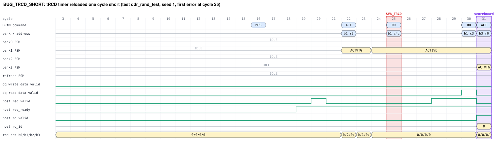

# Bug-Injection Detection Report

Generated by `scripts/bug_hunt.py`: each bug variant runs the standard `ddr_rand_test` (2000 requests) on seeds 1-2, once with every checker enabled and once with assertions disabled (`+no_sva`, i.e. scoreboard + DRAM model only). Campaign wall time 1.3 min.

**Control:** the clean RTL passes 2/2 of the same seeds (no false positives).

| Bug | Category | Detected (all checkers) | Detected (no SVA) | First detector | First detection cycle (min / median) | Reproducer |
|---|---|---|---|---|---|---|
| [`BUG_TRCD_SHORT`](#bug_trcd_short) | DRAM timing | 2/2 | 2/2 | SVA protocol (2) | 25 / 34 | seed 1 |
| [`BUG_RAW_HAZARD`](#bug_raw_hazard) | Race condition / ordering | 2/2 | 2/2 | scoreboard (2) | 861 / 945 | seed 2 |

Reproduce any entry with `make run BUG=<bug> TEST=ddr_rand_test SEED=<seed> NUM_TXN=2000 WAVES=1 TRACE=1` (waveform in `out/<bug>/.../waves.vcd`).

## BUG_TRCD_SHORT

**tRCD timer reloaded one cycle short** (DRAM timing). The ACT->column timer is loaded with tRCD-2 instead of tRCD-1, so the bank FSM reaches ACTIVE one cycle early and RD/WR is issued 3 cycles after ACT (tRCD = 4).

Injected defect:

```systemverilog
// rtl/ddr_ctrl.sv:69
`ifdef BUG_TRCD_SHORT
  localparam int RCD_LOAD = T_RCD - 2;
`else
  localparam int RCD_LOAD = T_RCD - 1;
`endif
```

- Failing seeds (all checkers): 1, 2
- Failing seeds (scoreboard + DRAM model only): 1, 2 (first ids: SB_DATA_MISMATCH, median cycle 48)
- Error ids raised: `SVA_TRCD` x15, `SB_DATA_MISMATCH` x5
- First failure (seed 1, cycle 25): `[SVA_TRCD]` bank 1 RD 3 cycles after ACT (tRCD=4): premature column access



Log excerpt: [`docs/bug_logs/BUG_TRCD_SHORT.log`](../docs/bug_logs/BUG_TRCD_SHORT.log)

## BUG_RAW_HAZARD

**FR-FCFS reorder ignores same-address hazards** (Race condition / ordering). The scheduler's 'is there an older request to the same address' check is removed. A younger read can then bypass an older write to the same address (it prefers the current bus direction) and returns stale data. No DRAM protocol rule is broken.

Injected defect:

```systemverilog
// rtl/ddr_ctrl.sv:144
`ifndef BUG_RAW_HAZARD
        for (int j = 0; j < i; j++)
          if (q[b][j].row == q[b][i].row && q[b][j].col == q[b][i].col)
            haz_v[b][i] = 1'b1;
`endif
```

- Failing seeds (all checkers): 1, 2
- Failing seeds (scoreboard + DRAM model only): 1, 2 (first ids: SB_DATA_MISMATCH, median cycle 945)
- Error ids raised: `SB_DATA_MISMATCH` x20
- First failure (seed 2, cycle 861): `[SB_DATA_MISMATCH]` read id=167 ba=3 row=0x006 col=0x17 accepted @849 returned @861 | expected 0xd52871d25e774f1a | actual   0xf33b269d7289f9b9  (xor 0x2613574f2cfeb6a3) | last writer id=165 @847 | diagnosis: stale data: value from 1 write(s) earlier (ordering / hazard violation)


Log excerpt: [`docs/bug_logs/BUG_RAW_HAZARD.log`](../docs/bug_logs/BUG_RAW_HAZARD.log)

